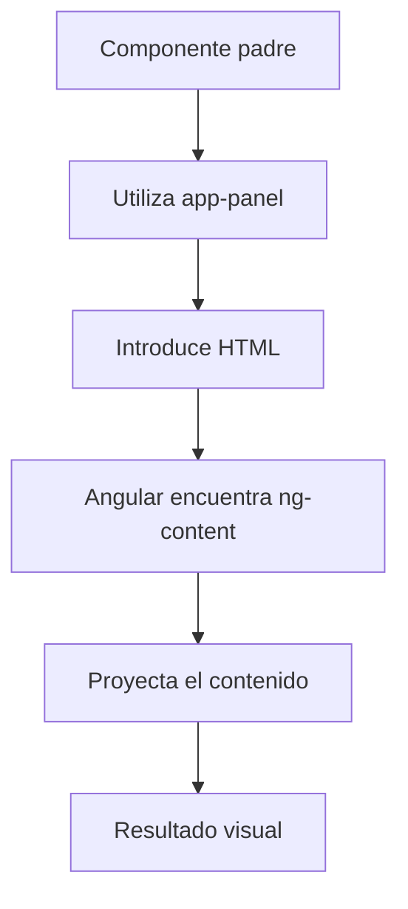
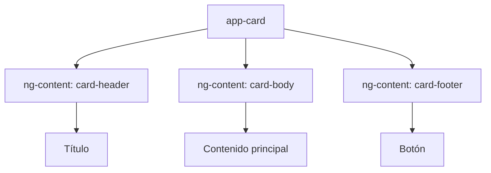
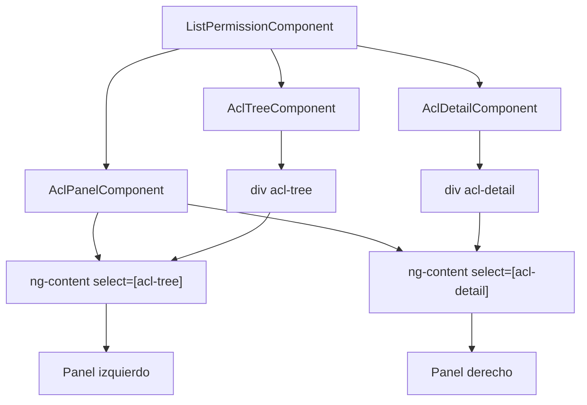

# Angular: Proyección de contenido con `ng-content`

## Índice

1. [Introducción](#1-introducción)
2. [¿Qué es ng-content?](#2-qué-es-ng-content)
3. [Nivel básico: primera proyección](#3-nivel-básico-primera-proyección)
  - 3.1. Crear el componente hijo
  - 3.2. Utilizar el componente padre
  - 3.3. Flujo de funcionamiento
4. [Nivel intermedio: proyección con select](#4-nivel-intermedio-proyección-con-select)
  - 4.1. Proyección con varios espacios
  - 4.2. Ejemplo práctico con ACL
  - 4.3. Tipos de selectores
  - 4.4. Qué sucede si no hay coincidencias
5. [Sin utilizar ng-content](#5-sin-utilizar-ng-content)
  - 5.1. Componente con contenido propio
  - 5.2. Utilizar inputs y outputs
  - 5.3. Comparación con ng-content
6. [Nivel PRO: conceptos avanzados](#6-nivel-pro-conceptos-avanzados)
  - 6.1. Proyección con ngProjectAs
  - 6.2. Contenido alternativo
  - 6.3. Consultar contenido proyectado
  - 6.4. Contenido dinámico y ng-template
  - 6.5. Contexto de ejecución
7. [Errores frecuentes](#7-errores-frecuentes)
8. [Buenas prácticas](#8-buenas-prácticas)
9. [Resumen final](#9-resumen-final)

---

# 1. Introducción

Angular permite crear componentes reutilizables. Un componente puede contener su propio HTML o permitir que otros componentes introduzcan contenido dentro de él.

Para conseguirlo, Angular proporciona una funcionalidad denominada **Content Projection**, cuya principal herramienta es `ng-content`.

Esta funcionalidad permite separar:

- La estructura visual de un componente.
- El contenido que se quiere mostrar.
- La lógica de los componentes que participan.

Por ejemplo, podemos crear un panel reutilizable que tenga dos zonas:

- Una zona izquierda para mostrar un árbol.
- Una zona derecha para mostrar los detalles del elemento seleccionado.

El panel no necesita conocer cómo funcionan el árbol o los detalles. Solamente define dónde debe aparecer cada uno.

## 1.1. ¿Qué vamos a aprender?

Al terminar esta documentación podremos:

- Comprender cómo funciona `ng-content`.
- Crear componentes reutilizables.
- Proyectar contenido en una única zona.
- Proyectar contenido en varias zonas.
- Utilizar selectores para organizar el contenido.
- Diferenciar la proyección de contenido del uso de `@Input()` y `@Output()`.
- Comprender cuándo utilizar `ng-template` en lugar de `ng-content`.

---

# 2. ¿Qué es ng-content?

`ng-content` es una instrucción de Angular que permite proyectar contenido HTML dentro de un componente.

En otras palabras, permite que el componente que utilizamos desde fuera proporcione el contenido que se visualizará dentro de su estructura.

Su sintaxis básica es:

```html
<ng-content></ng-content>
```

Podemos imaginarlo como un espacio reservado que se rellenará con el contenido que reciba el componente.

## 2.1. Representación visual

**Componente reutilizable:**

<pre>
┌──────────────────────────────┐
│       MI COMPONENTE          │
│                              │
│      ┌────────────────┐      │
│      │                │      │
│      │  ng-content    │      │
│      │                │      │
│      └────────────────┘      │
│                              │
└──────────────────────────────┘
</pre>

**Componente utilizado desde otro componente:**

```html
<app-panel>
  <h2>Hola, Angular</h2>
  <p>Este contenido viene del exterior.</p>
</app-panel>
```

El resultado visual será:

<pre>
┌──────────────────────────────┐
│          MI PANEL            │
│                              │
│       Hola, Angular          │
│                              │
│  Este contenido viene del    │
│  exterior.                   │
│                              │
└──────────────────────────────┘
</pre>

El componente `app-panel` proporciona la estructura y el componente que lo utiliza proporciona el contenido.

---

# 3. Nivel básico: primera proyección

Vamos a crear un ejemplo sencillo para entender el funcionamiento.

Nuestro objetivo será crear un componente llamado `AppPanelComponent` que permita introducir contenido desde otro componente.

## 3.1. Crear el componente hijo

Primero creamos el componente que recibirá el contenido.

**app-panel.component.ts**

```typescript
import { Component } from '@angular/core';

@Component({
  selector: 'app-panel',
  standalone: true,
  templateUrl: './app-panel.component.html',
})
export class AppPanelComponent {}
```

Observamos que el componente no necesita propiedades ni métodos.

Esto se debe a que solamente se encarga de proporcionar una estructura.

**app-panel.component.html**

```html
<div class="panel">
  <h2>Mi panel</h2>

  <ng-content></ng-content>
</div>
```

El elemento `ng-content` indica dónde se mostrará el contenido externo.

## 3.2. Utilizar el componente padre

Ahora utilizamos nuestro componente desde otro componente.

**app.component.ts**

```typescript
import { Component } from '@angular/core';
import { AppPanelComponent } from './app-panel.component';

@Component({
  selector: 'app-root',
  standalone: true,
  imports: [AppPanelComponent],
  templateUrl: './app.component.html',
})
export class AppComponent {}
```

**app.component.html**

```html
<app-panel>
  <h3>Bienvenido</h3>

  <p>
    Este contenido se proyecta dentro del panel.
  </p>

  <button>Continuar</button>
</app-panel>
```

El contenido que escribimos dentro de `app-panel` aparecerá en el lugar donde hemos colocado `ng-content`.

## 3.3. Flujo de funcionamiento



**Importante:** `ng-content` no crea una copia del HTML ni convierte el contenido en una cadena. Angular proyecta los nodos de contenido proporcionados por el componente que utiliza el panel.

---

# 4. Nivel intermedio: proyección con select

Hasta ahora hemos utilizado una única zona de proyección.

Sin embargo, en aplicaciones reales podemos necesitar diferentes zonas para organizar el contenido.

Para conseguirlo utilizamos el atributo `select` de `ng-content`.

Su sintaxis es:

```html
<ng-content select="[nombre-atributo]"></ng-content>
```

El selector indica qué elementos externos deben aparecer en esa zona.

## 4.1. Proyección con varios espacios

Imaginemos que queremos crear un componente que tenga:

- Una cabecera.
- Un contenido principal.
- Un pie de página.

**app-card.component.html**

```html
<div class="card">

  <header class="card__header">
    <ng-content select="[card-header]"></ng-content>
  </header>

  <main class="card__body">
    <ng-content select="[card-body]"></ng-content>
  </main>

  <footer class="card__footer">
    <ng-content select="[card-footer]"></ng-content>
  </footer>

</div>
```

Ahora podemos utilizarlo de esta manera:

```html
<app-card>

  <h2 card-header>
    Mi título
  </h2>

  <p card-body>
    Este es el contenido principal.
  </p>

  <button card-footer>
    Guardar
  </button>

</app-card>
```

Cada elemento se coloca en su correspondiente espacio.

### Representación visual



## 4.2. Ejemplo práctico con ACL

Vamos a utilizar un ejemplo más cercano a una aplicación real.

Tenemos tres componentes:

| Componente | Responsabilidad |
|---|---|
| `AclPanelComponent` | Organizar el panel |
| `AclTreeComponent` | Mostrar el árbol de permisos |
| `AclDetailComponent` | Mostrar los detalles del nodo seleccionado |

El panel no necesita conocer cómo se construye el árbol ni cómo se muestran sus detalles.

Solamente debe proporcionar los espacios donde aparecerán.

### A. Componente AclPanelComponent

**acl-panel.component.ts**

```typescript
import { Component } from '@angular/core';

@Component({
  selector: 'shared-acl-panel',
  standalone: true,
  templateUrl: './acl-panel.component.html',
})
export class AclPanelComponent {}
```

**acl-panel.component.html**

```html
<div class="acl-panel">

  <!-- Panel izquierdo -->
  <aside class="acl-panel__tree">
    <ng-content select="[acl-tree]"></ng-content>
  </aside>

  <!-- Panel derecho -->
  <section class="acl-panel__detail">
    <ng-content select="[acl-detail]"></ng-content>
  </section>

</div>
```

Observamos que tenemos dos zonas de proyección:

- `[acl-tree]`: recibe el contenido del árbol.
- `[acl-detail]`: recibe el contenido de los detalles.

### B. Utilizar el componente desde el padre

En nuestro componente de listado de permisos podemos utilizar el panel de esta forma:

```html
@if (loading()) {

  <shared-spinner />

} @else if (aclNodes().length === 0) {

  <p>No hay permisos disponibles.</p>

} @else {

  <shared-acl-panel>

    <!-- Árbol de permisos -->
    <div acl-tree>

      <shared-acl-tree
        [nodes]="aclNodes()"
        [selectable]="true"
        [selectedIds]="selectedIds()"
        [selectedNodeId]="selectedNode()?.id ?? null"
        (selectionChange)="onSelectionChange($event)"
        (nodeSelected)="onNodeSelected($event)"
      />

    </div>

    <!-- Detalles del nodo -->
    <div acl-detail>

      <shared-acl-detail
        [node]="selectedNode()"
      />

    </div>

  </shared-acl-panel>

}
```

**¿Por qué utilizamos `div` con los atributos `acl-tree` y `acl-detail`?**

Porque estos elementos son los que Angular utiliza para identificar qué contenido debe proyectar en cada zona.

El atributo debe estar en el elemento que se proyecta, no en el componente que queremos introducir.

Por ejemplo:

```html
<!-- CORRECTO -->
<div acl-tree>
  <shared-acl-tree />
</div>
```

```html
<!-- INCORRECTO PARA NUESTRA ESTRUCTURA -->
<shared-acl-tree acl-detail />
```

En el segundo ejemplo estamos indicando que el árbol pertenece a la zona de detalles, cuando realmente queremos mostrarlo en la zona del árbol.

### C. Resultado visual

```text
┌─────────────────────────────────────────────┐
│                 ACL PANEL                   │
├──────────────────────┬──────────────────────┤
│                      │                      │
│   ÁRBOL DE PERMISOS  │   DETALLES            │
│                      │                      │
│   ☑ Contexto         │   Nodo seleccionado  │
│      ☑ Rol           │                      │
│         ☑ Permiso    │   Nombre: Person     │
│         ☐ Permiso    │   Tipo: PERMISSION   │
│                      │   Descripción: ...   │
│                      │                      │
└──────────────────────┴──────────────────────┘
```

### D. Flujo completo



La idea principal es que `AclPanelComponent` controla la distribución visual, mientras que los otros componentes mantienen sus propias responsabilidades.

## 4.3. Tipos de selectores

El atributo `select` permite utilizar diferentes selectores CSS.

| Selector | Qué selecciona | Ejemplo |
|---|---|---|
| `[nombre]` | Elementos con un atributo | `[acl-tree]` |
| `.nombre` | Elementos con una clase | `.header` |
| `nombre` | Elementos con una etiqueta | `header` |
| `*` | Cualquier contenido restante | `select="*"` |

Ejemplos:

```html
<!-- Por atributo -->
<ng-content select="[header]"></ng-content>

<!-- Por clase -->
<ng-content select=".header"></ng-content>

<!-- Por etiqueta -->
<ng-content select="header"></ng-content>

<!-- Contenido restante -->
<ng-content select="*"></ng-content>
```

### 4.4. ¿Qué sucede si no hay coincidencias?

Supongamos que tenemos:

```html
<ng-content select="[header]"></ng-content>

<ng-content select="[body]"></ng-content>
```

Pero utilizamos el componente de esta forma:

```html
<app-card>
  <p>Hola</p>
</app-card>
```

El elemento `p` no coincide con ninguno de los selectores.

Por tanto, no se mostrará en esas zonas.

Para evitar perder contenido que no coincide podemos añadir una zona de contenido genérico:

```html
<ng-content select="[header]"></ng-content>

<ng-content select="[body]"></ng-content>

<ng-content></ng-content>
```

El último `ng-content` recibe el contenido que no ha sido asignado a las zonas anteriores.

---

# 5. Sin utilizar ng-content

No todos los componentes necesitan utilizar proyección de contenido.

Podemos construir componentes reutilizables sin utilizar `ng-content`.

En este caso, el componente define directamente su estructura HTML y utiliza propiedades para recibir información.

## 5.1. Componente con contenido propio

Por ejemplo, vamos a crear un componente que muestra una tarjeta de usuario.

**user-card.component.ts**

```typescript
import { Component, input } from '@angular/core';

@Component({
  selector: 'app-user-card',
  standalone: true,
  templateUrl: './user-card.component.html',
})
export class UserCardComponent {

  name = input.required<string>();

  email = input.required<string>();

}
```

**user-card.component.html**

```html
<div class="user-card">

  <h2>{{ name() }}</h2>

  <p>{{ email() }}</p>

</div>
```

El componente conoce su propia estructura y recibe los datos mediante `input()`.

## 5.2. Utilizar el componente padre

```html
<app-user-card
  [name]="'Andrés'"
  [email]="'andres@example.com'"
/>
```

En este ejemplo no necesitamos `ng-content`.

El componente recibe los datos y los representa utilizando su propio HTML.

## 5.3. Utilizar inputs y outputs

También podemos utilizar eventos para comunicar información al componente padre.

**user-card.component.ts**

```typescript
import { Component, input, output } from '@angular/core';

@Component({
  selector: 'app-user-card',
  standalone: true,
  templateUrl: './user-card.component.html',
})
export class UserCardComponent {

  name = input.required<string>();

  email = input.required<string>();

  userSelected = output<string>();

  selectUser(): void {
    this.userSelected.emit(this.name());
  }

}
```

**user-card.component.html**

```html
<div class="user-card">

  <h2>{{ name() }}</h2>

  <p>{{ email() }}</p>

  <button (click)="selectUser()">
    Seleccionar usuario
  </button>

</div>
```

Desde el componente padre:

```html
<app-user-card
  [name]="'Andrés'"
  [email]="'andres@example.com'"
  (userSelected)="onUserSelected($event)"
/>
```

De esta forma:

- `input()` permite recibir información.
- `output()` permite emitir eventos.
- El componente padre puede reaccionar a esos eventos.

## 5.4. Comparación: con y sin ng-content

| Característica | Con ng-content | Sin ng-content |
|---|---|---|
| Recibir contenido HTML externo | Sí | No, no mediante proyección |
| Recibir datos | Puede combinarse con inputs | Sí |
| Emitir eventos | Puede combinarse con outputs | Sí |
| Controlar la estructura HTML | El componente receptor define los espacios | El propio componente define toda su estructura |
| Reutilizar diferentes estructuras | Muy flexible | Más limitado |
| Complejidad | Depende de las zonas de proyección | Generalmente sencilla |

**¿Cuándo utilizar cada alternativa?**

Utilizaremos `ng-content` cuando queramos crear componentes cuya estructura sea reutilizable, pero cuyo contenido pueda variar.

Utilizaremos `input()` cuando el componente deba recibir datos para construir su propia interfaz.

Utilizaremos `output()` cuando el componente necesite comunicar acciones o eventos al componente padre.

Estas herramientas no son excluyentes. Podemos combinarlas en un mismo componente.

---

# 6. Nivel PRO: conceptos avanzados

En este apartado veremos algunas funcionalidades que permiten controlar mejor la proyección de contenido.

## 6.1. Proyección con ngProjectAs

En ocasiones, un elemento no tiene el atributo o la clase que espera el selector de `ng-content`.

Para resolverlo podemos utilizar `ngProjectAs`.

Este atributo permite indicar a Angular que trate un elemento como si coincidiera con otro selector durante la proyección.

Ejemplo:

```html
<app-card>

  <h2 ngProjectAs="[card-header]">
    Mi título
  </h2>

</app-card>
```

El componente receptor:

```html
<div class="card">
  <ng-content select="[card-header]"></ng-content>
</div>
```

Aunque el elemento `h2` no tiene realmente el atributo `card-header`, Angular lo proyecta en esa zona porque hemos indicado `ngProjectAs`.

**Importante:** `ngProjectAs` modifica la identidad utilizada para la proyección, no añade físicamente el atributo al HTML.

## 6.2. Contenido alternativo

Angular permite definir contenido alternativo dentro de `ng-content`.

Esto resulta útil cuando no se proporciona contenido para una zona.

Ejemplo:

```html
<div class="card">

  <ng-content select="[card-header]">
    <h2>Sin título</h2>
  </ng-content>

  <ng-content select="[card-body]">
    <p>No hay contenido disponible.</p>
  </ng-content>

</div>
```

Si no se proporciona contenido para esos espacios, Angular mostrará el contenido alternativo.

Uso:

```html
<app-card>
  <p card-body>Contenido disponible.</p>
</app-card>
```

En este caso se mostrará el cuerpo proporcionado y el título alternativo.

## 6.3. Consultar contenido proyectado

En ocasiones necesitamos conocer qué componentes o elementos han sido proyectados dentro de nuestro componente.

Para ello Angular proporciona las consultas de contenido:

- `contentChild()`: obtiene el primer elemento o directiva que coincide.
- `contentChildren()`: obtiene los elementos o directivas que coinciden.

Estas son consultas basadas en señales disponibles en las versiones modernas de Angular.

Ejemplo:

```typescript
import {
  Component,
  contentChild,
  ElementRef,
} from '@angular/core';

@Component({
  selector: 'app-panel',
  standalone: true,
  template: `
    <ng-content></ng-content>
  `,
})
export class AppPanelComponent {

  content = contentChild<ElementRef>('panelContent');

}
```

Uso:

```html
<app-panel>

  <p #panelContent>
    Contenido proyectado.
  </p>

</app-panel>
```

Ahora podemos consultar el elemento proyectado mediante:

```typescript
this.content()
```

El resultado será el elemento correspondiente o `undefined` si todavía no existe una coincidencia.

**Diferencia importante:**

| Consulta | Qué consulta |
|---|---|
| `viewChild()` | Elementos de la plantilla propia del componente |
| `viewChildren()` | Varios elementos de la plantilla propia |
| `contentChild()` | Primer elemento del contenido proyectado |
| `contentChildren()` | Elementos del contenido proyectado |

## 6.4. Contenido dinámico y ng-template

Una limitación importante de `ng-content` es que la proyección no es una herramienta para crear contenido dinámicamente.

Por ejemplo, no debemos utilizar `@if` para intentar crear o eliminar dinámicamente una zona de proyección:

```html
<!-- No recomendado -->
@if (showContent()) {
  <ng-content></ng-content>
}
```

Angular procesa los espacios `ng-content` durante la compilación.

Si necesitamos controlar dinámicamente cuándo se crea o se muestra contenido, podemos utilizar `ng-template` y `NgTemplateOutlet`.

Ejemplo:

**dynamic-panel.component.ts**

```typescript
import { Component, input } from '@angular/core';
import { NgTemplateOutlet } from '@angular/common';

@Component({
  selector: 'app-dynamic-panel',
  standalone: true,
  imports: [NgTemplateOutlet],
  templateUrl: './dynamic-panel.component.html',
})
export class DynamicPanelComponent {

  showContent = input<boolean>(true);

}
```

**dynamic-panel.component.html**

```html
@if (showContent()) {

  <ng-container
    [ngTemplateOutlet]="contentTemplate"
  />

}

<ng-template #contentTemplate>
  <p>Contenido dinámico.</p>
</ng-template>
```

En este ejemplo, `ng-template` define una plantilla que Angular puede instanciar cuando sea necesario.

Para recibir plantillas externas también podemos utilizar `TemplateRef` y `ngTemplateOutlet`.

Esta alternativa resulta especialmente útil cuando necesitamos controlar la creación, eliminación o reutilización de fragmentos de interfaz.

## 6.5. Contexto de ejecución

Este concepto es especialmente importante para comprender cómo funciona Angular.

Cuando proyectamos contenido:

```html
<app-panel>

  <p>{{ message() }}</p>

</app-panel>
```

La expresión `message()` pertenece al contexto del componente que proporciona el contenido, no al componente `app-panel`.

Es decir:

- El componente receptor controla dónde se muestra el contenido.
- El componente padre controla las expresiones y propiedades del contenido proyectado.

Por tanto, la proyección no transfiere automáticamente la lógica del componente padre al componente hijo.

---

# 7. Errores frecuentes

## 7.1. El contenido no aparece

**Problema:**

```html
<app-panel>
  <p>Hola</p>
</app-panel>
```

Pero el componente receptor no contiene ningún `ng-content`.

**Solución:**

```html
<div class="panel">
  <ng-content></ng-content>
</div>
```

Si el componente no tiene ningún espacio de proyección, el contenido externo no se mostrará.

## 7.2. El selector no coincide

**Problema:**

Componente receptor:

```html
<ng-content select="[acl-tree]"></ng-content>
```

Componente padre:

```html
<shared-acl-tree />
```

El elemento no tiene el atributo `acl-tree`.

**Solución:**

```html
<div acl-tree>
  <shared-acl-tree />
</div>
```

Ahora sí coincide con el selector.

## 7.3. Confundir inputs con proyección

**Incorrecto:**

```html
<app-panel [ng-content]="content" />
```

`ng-content` no es una propiedad que podamos asignar mediante un binding.

**Correcto:**

```html
<app-panel>
  <p>Contenido externo</p>
</app-panel>
```

## 7.4. Utilizar el selector equivocado

Si tenemos:

```html
<ng-content select="[acl-tree]"></ng-content>
```

Debemos proporcionar:

```html
<div acl-tree>
  Contenido del árbol
</div>
```

No debemos proporcionar:

```html
<div acl-detail>
  Contenido del árbol
</div>
```

Cada atributo debe coincidir con su correspondiente zona de proyección.

## 7.5. Confundir ng-content con ng-container

| Elemento | Función |
|---|---|
| `ng-content` | Proyectar contenido externo |
| `ng-container` | Agrupar elementos sin crear un elemento HTML adicional |
| `ng-template` | Definir una plantilla que no se representa automáticamente |
| `ngTemplateOutlet` | Instanciar una plantilla |

---

# 8. Buenas prácticas

Para desarrollar componentes reutilizables con Angular es recomendable seguir estas pautas:

1. Mantener una responsabilidad clara para cada componente.
2. Utilizar `ng-content` cuando necesitemos personalizar el contenido interno de un componente.
3. Utilizar `input()` para recibir datos.
4. Utilizar `output()` para comunicar eventos.
5. Utilizar selectores descriptivos, como `[card-header]` o `[acl-tree]`.
6. Evitar introducir lógica de negocio dentro de componentes que solamente organizan la interfaz.
7. Utilizar `ng-template` cuando necesitemos controlar la creación dinámica de contenido.
8. No utilizar `ng-content` innecesariamente si el componente siempre va a mostrar la misma estructura.

### Arquitectura recomendada

En el ejemplo ACL hemos separado correctamente las responsabilidades:

```text
ListPermissionComponent
│
├── AclPanelComponent
│   │
│   ├── Zona izquierda
│   │   └── AclTreeComponent
│   │
│   └── Zona derecha
│       └── AclDetailComponent
│
└── Lógica de selección
    ├── selectedNode()
    ├── selectedIds()
    ├── onSelectionChange()
    └── onNodeSelected()
```

El componente `AclPanelComponent` no necesita saber cómo se selecciona un permiso ni cómo se construye el árbol.

Su única responsabilidad es organizar visualmente el contenido.

---

# 9. Resumen final

## 9.1. Conceptos principales

| Concepto | Descripción |
|---|---|
| `ng-content` | Permite proyectar contenido externo |
| `select` | Identifica la zona donde se proyecta un elemento |
| `ngProjectAs` | Permite modificar el selector utilizado para proyectar un elemento |
| `contentChild()` | Consulta un elemento proyectado |
| `contentChildren()` | Consulta varios elementos proyectados |
| `ng-template` | Define una plantilla reutilizable |
| `ngTemplateOutlet` | Permite instanciar una plantilla |
| `input()` | Recibe datos desde el componente padre |
| `output()` | Emite eventos hacia el componente padre |

## 9.2. ¿Qué debemos recordar?

**Nivel básico**

`ng-content` permite introducir contenido externo dentro de un componente.

**Nivel intermedio**

`select` permite crear diferentes zonas de proyección y organizar el contenido.

**Nivel PRO**

Podemos utilizar `ngProjectAs`, consultas de contenido y `ng-template` para resolver necesidades más avanzadas.

## 9.3. Regla mental

Podemos recordar la diferencia entre estas herramientas de una forma sencilla:

- `ng-content`: ¿Dónde quiero mostrar contenido externo?
- `input()`: ¿Qué información necesita recibir mi componente?
- `output()`: ¿Qué eventos necesita comunicar?
- `ng-template`: ¿Qué contenido quiero definir para instanciarlo cuando sea necesario?

**Conclusión:** `ng-content` es especialmente útil para construir componentes reutilizables, desacoplados y flexibles. Permite separar la estructura visual del contenido, facilitando el mantenimiento y la evolución de una aplicación Angular.
