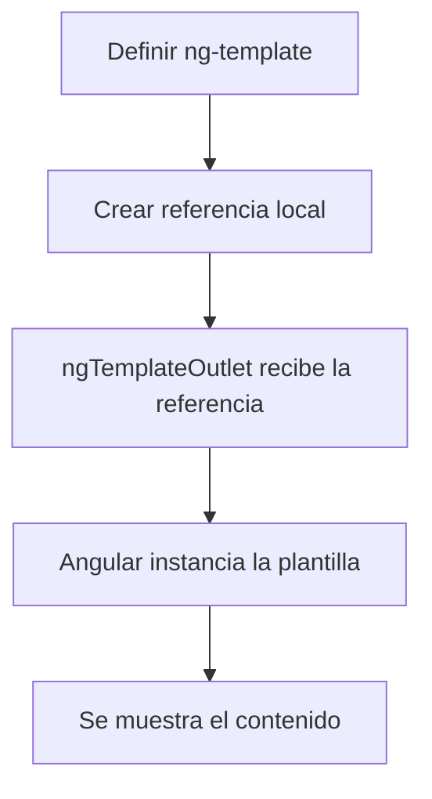
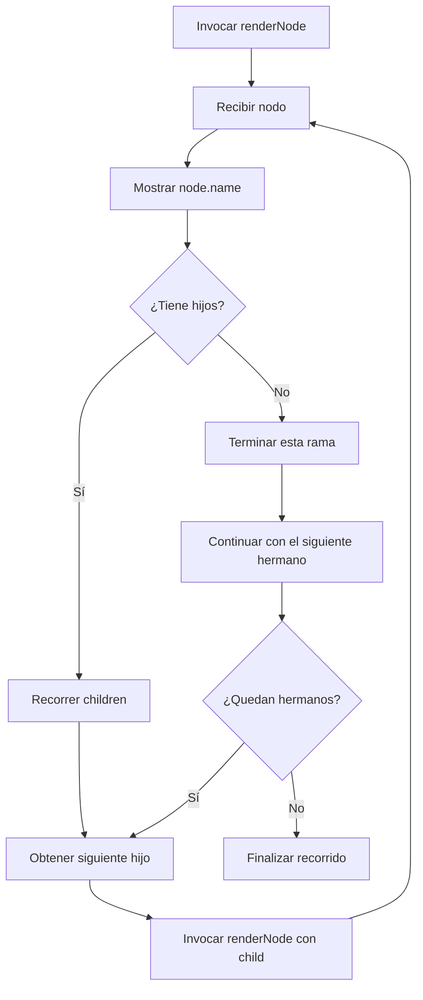
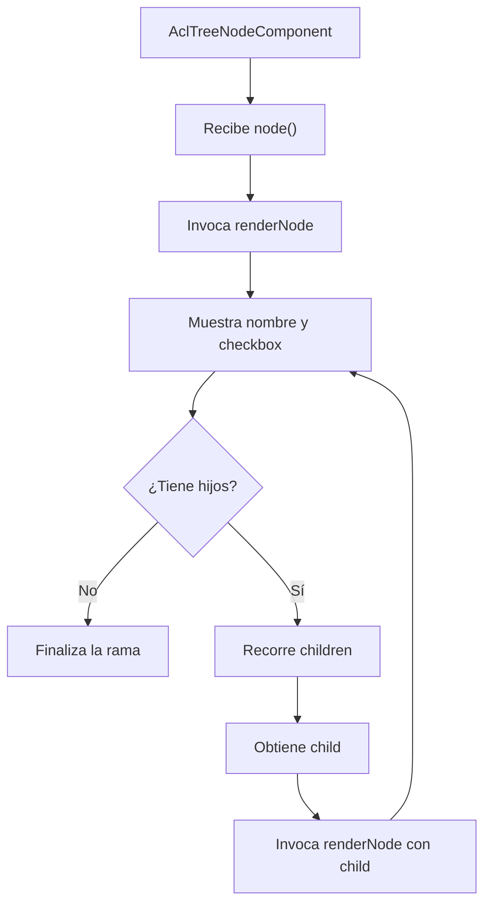
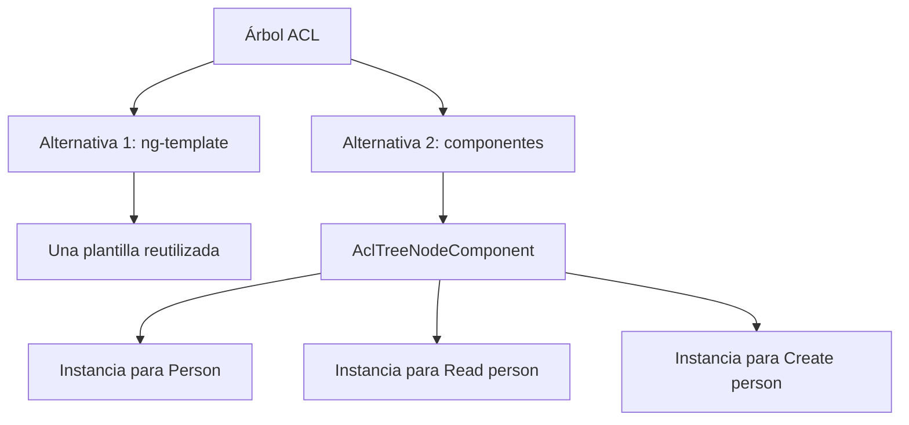
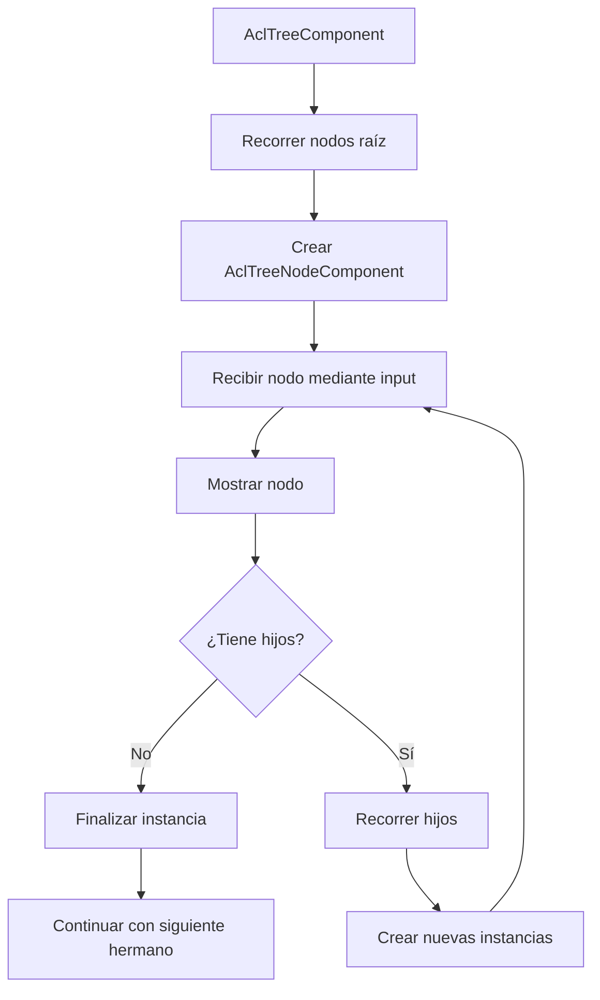

# Angular: ng-template, ngTemplateOutlet y plantillas recursivas

## Índice

1. [Introducción](#1-introducción)
2. [¿Qué es ng-template?](#2-qué-es-ng-template)
3. [Nivel básico: crear y mostrar plantillas](#3-nivel-básico-crear-y-mostrar-plantillas)
  - 3.1. Definir una plantilla
  - 3.2. Mostrar una plantilla con ngTemplateOutlet
  - 3.3. Diferencia entre ng-template y HTML normal
  - 3.4. Flujo de funcionamiento
4. [Nivel intermedio: reutilización y contextos](#4-nivel-intermedio-reutilización-y-contextos)
  - 4.1. Reutilizar una plantilla
  - 4.2. Pasar parámetros con ngTemplateOutletContext
  - 4.3. Diferencia entre $implicit y las propiedades con nombre
  - 4.4. Utilizar plantillas con condiciones
5. [Nivel PRO: plantillas recursivas](#5-nivel-pro-plantillas-recursivas)
  - 5.1. ¿Qué es la recursividad?
  - 5.2. ¿Por qué necesitamos recursividad?
  - 5.3. Crear una estructura de árbol
  - 5.4. Crear una plantilla recursiva
  - 5.5. Invocar la plantilla por primera vez
  - 5.6. Comprender la ejecución paso a paso
  - 5.7. Diagrama de flujo
6. [Aplicación práctica: árbol ACL](#6-aplicación-práctica-árbol-acl)
  - 6.1. Modelo de datos
  - 6.2. Datos de ejemplo
  - 6.3. Implementación de AclTreeNodeComponent
  - 6.4. Explicación del código
  - 6.5. Representación visual
7. [Tipos y conceptos importantes](#7-tipos-y-conceptos-importantes)
8. [Errores frecuentes](#8-errores-frecuentes)
9. [Buenas prácticas](#9-buenas-prácticas)
10. [Ejercicios prácticos](#10-ejercicios-prácticos)
11. [Resumen final](#11-resumen-final)

---

# 1. Introducción

Angular permite definir fragmentos de HTML que no se muestran inmediatamente, sino que pueden reutilizarse cuando sea necesario.

Para conseguirlo dispone de dos herramientas importantes:

- `ng-template`: permite definir una plantilla.
- `ngTemplateOutlet`: permite insertar una plantilla en un lugar determinado.

Estas herramientas son especialmente interesantes cuando necesitamos reutilizar una misma estructura HTML varias veces.

Por ejemplo:

- Mostrar diferentes tarjetas utilizando la misma estructura.
- Crear tablas con filas personalizadas.
- Representar menús anidados.
- Mostrar árboles de categorías.
- Representar árboles de permisos.
- Construir estructuras recursivas de cualquier profundidad.

En esta documentación utilizaremos ejemplos sencillos y terminaremos implementando un árbol recursivo como el que utilizamos en nuestro módulo ACL.

# 2. ¿Qué es ng-template?

`ng-template` es una directiva estructural de Angular que permite definir una plantilla HTML que no se representa directamente en pantalla.

Su contenido queda definido y puede utilizarse posteriormente.

Su sintaxis básica es:

```html
<ng-template #miPlantilla>

  <p>Hola, Angular</p>

</ng-template>
```

Analicemos las partes:

| Elemento | Significado |
|---|---|
| `ng-template` | Define una plantilla |
| `#miPlantilla` | Crea una referencia local a la plantilla |
| Contenido interno | HTML que se mostrará cuando se instancie la plantilla |

**Importante:** definir una plantilla no significa que se esté mostrando.

Por ejemplo:

```html
<ng-template #miPlantilla>
  <h2>Hola, Angular</h2>
</ng-template>
```

Este código no mostrará nada por sí solo.

Para mostrarlo necesitamos utilizar `ngTemplateOutlet`.

# 3. Nivel básico: crear y mostrar plantillas

## 3.1. Definir una plantilla

Vamos a crear una plantilla sencilla que muestre un mensaje.

```html
<ng-template #welcomeTemplate>

  <h2>Bienvenido</h2>

  <p>Estás aprendiendo Angular.</p>

</ng-template>
```

En este momento hemos definido la plantilla, pero todavía no aparece en pantalla.

## 3.2. Mostrar una plantilla con ngTemplateOutlet

Para mostrarla utilizamos `ngTemplateOutlet`.

```html
<ng-template #welcomeTemplate>

  <h2>Bienvenido</h2>

  <p>Estás aprendiendo Angular.</p>

</ng-template>

<ng-container
  [ngTemplateOutlet]="welcomeTemplate"
/>
```

Ahora sí se mostrará el contenido.

El funcionamiento es el siguiente:

1. Angular encuentra la plantilla `welcomeTemplate`.
2. `ngTemplateOutlet` recibe la referencia a esa plantilla.
3. Angular instancia la plantilla.
4. El contenido se representa en el lugar donde está el `ng-container`.

**¿Qué es ng-container?**

Es un contenedor lógico de Angular que permite agrupar o insertar contenido sin generar un elemento HTML adicional.

Por tanto, no aparecerá un elemento `div` o `span` adicional en el DOM.

### Resultado visual

<pre>
┌───────────────────────────────┐
│           Bienvenido          │
│                               │
│  Estás aprendiendo Angular.   │
└───────────────────────────────┘
</pre>

## 3.3. Diferencia entre ng-template y HTML normal

Veamos dos ejemplos.

**Ejemplo A: HTML normal**

```html
<div>
  <h2>Bienvenido</h2>
</div>
```

El contenido se representa directamente.

**Ejemplo B: ng-template**

```html
<ng-template #welcomeTemplate>

  <h2>Bienvenido</h2>

</ng-template>
```

El contenido no se representa automáticamente.

Necesitamos instanciarlo:

```html
<ng-container
  [ngTemplateOutlet]="welcomeTemplate"
/>
```

Comparación:

| Característica | HTML normal | ng-template |
|---|---|---|
| Se representa directamente | Sí | No |
| Puede reutilizarse como plantilla | No directamente | Sí |
| Permite recibir contexto | No como plantilla | Sí |
| Permite instanciación mediante outlet | No | Sí |

## 3.4. Flujo de funcionamiento



# 4. Nivel intermedio: reutilización y contextos

Una de las mayores ventajas de `ng-template` es que podemos utilizar una misma plantilla varias veces.

Además, podemos enviar información diferente en cada utilización.

## 4.1. Reutilizar una plantilla

Imaginemos que queremos mostrar varias tarjetas con una misma estructura.

Primero definimos la plantilla:

```html
<ng-template #userCard>

  <div class="card">
    <h3>Usuario</h3>
    <p>Información del usuario.</p>
  </div>

</ng-template>
```

Ahora podemos instanciarla varias veces:

```html
<ng-container
  [ngTemplateOutlet]="userCard"
/>

<ng-container
  [ngTemplateOutlet]="userCard"
/>

<ng-container
  [ngTemplateOutlet]="userCard"
/>
```

Estamos utilizando la misma plantilla tres veces.

Sin embargo, las tres tarjetas muestran exactamente la misma información.

Para cambiar esto necesitamos utilizar contextos.

## 4.2. Pasar parámetros con ngTemplateOutletContext

`ngTemplateOutletContext` permite proporcionar información a una plantilla cuando se instancia.

Vamos a modificar el ejemplo anterior.

**Definición de la plantilla:**

```html
<ng-template #userCard let-name>

  <div class="card">

    <h3>{{ name }}</h3>

  </div>

</ng-template>
```

Ahora nuestra plantilla recibe una variable llamada `name`.

**Utilización de la plantilla:**

```html
<ng-container
  [ngTemplateOutlet]="userCard"
  [ngTemplateOutletContext]="{
    $implicit: 'Andrés'
  }"
/>

<ng-container
  [ngTemplateOutlet]="userCard"
  [ngTemplateOutletContext]="{
    $implicit: 'María'
  }"
/>

<ng-container
  [ngTemplateOutlet]="userCard"
  [ngTemplateOutletContext]="{
    $implicit: 'Carlos'
  }"
/>
```

### Resultado

<pre>
┌──────────────────────┐
│       Andrés         │
└──────────────────────┘

┌──────────────────────┐
│       María          │
└──────────────────────┘

┌──────────────────────┐
│       Carlos         │
└──────────────────────┘
</pre>

La plantilla es la misma, pero recibe información diferente en cada instancia.

## 4.3. Diferencia entre $implicit y las propiedades con nombre

Angular permite enviar información mediante un objeto de contexto.

Existen dos formas principales de recuperar esos valores.

### A. Utilizando $implicit

`$implicit` es una propiedad especial que permite proporcionar el valor predeterminado de la plantilla.

Ejemplo:

```html
<ng-template #userTemplate let-name>

  <p>Usuario: {{ name }}</p>

</ng-template>
```

Su utilización:

```html
<ng-container
  [ngTemplateOutlet]="userTemplate"
  [ngTemplateOutletContext]="{
    $implicit: 'Andrés'
  }"
/>
```

La variable `name` recibe el valor de `$implicit`.

### B. Utilizando propiedades con nombre

También podemos definir propiedades específicas.

```html
<ng-template #userTemplate let-name="userName">

  <p>Usuario: {{ name }}</p>

</ng-template>
```

Su utilización:

```html
<ng-container
  [ngTemplateOutlet]="userTemplate"
  [ngTemplateOutletContext]="{
    userName: 'Andrés'
  }"
/>
```

En este caso:

- `userName` es la propiedad del objeto de contexto.
- `name` es la variable local de la plantilla.

### C. Utilizar varios parámetros

Podemos combinar ambas opciones.

```html
<ng-template
  #userTemplate
  let-name
  let-email="userEmail"
>

  <div class="card">

    <h3>{{ name }}</h3>

    <p>{{ email }}</p>

  </div>

</ng-template>
```

Instanciamos la plantilla:

```html
<ng-container
  [ngTemplateOutlet]="userTemplate"
  [ngTemplateOutletContext]="{
    $implicit: 'Andrés',
    userEmail: 'andres@example.com'
  }"
/>
```

Resultado:

```text
Andrés
andres@example.com
```

### Tabla comparativa

| Sintaxis | Valor obtenido |
|---|---|
| `let-name` | `$implicit` |
| `let-name="userName"` | `userName` |
| `let-email="userEmail"` | `userEmail` |

La regla es sencilla:

- `let-variable` obtiene `$implicit`.
- `let-variable="propiedad"` obtiene la propiedad indicada.

## 4.4. Utilizar plantillas con condiciones

También podemos combinar `ng-template` con las condiciones de Angular.

Por ejemplo:

```html
<ng-template #loadingTemplate>

  <p>Cargando información...</p>

</ng-template>

<ng-template #dataTemplate>

  <p>Información cargada correctamente.</p>

</ng-template>

@if (loading()) {

  <ng-container
    [ngTemplateOutlet]="loadingTemplate"
  />

} @else {

  <ng-container
    [ngTemplateOutlet]="dataTemplate"
  />

}
```

Aquí tenemos dos plantillas diferentes y mostramos una u otra dependiendo del estado del componente.

# 5. Nivel PRO: plantillas recursivas

Llegamos a uno de los usos más interesantes de `ng-template`.

Vamos a estudiar cómo utilizar una plantilla para representarse a sí misma.

Esta técnica permite crear estructuras recursivas.

## 5.1. ¿Qué es la recursividad?

La recursividad es una técnica de programación en la que una función, método o estructura se llama a sí misma para resolver un problema.

Por ejemplo, imaginemos una estructura de carpetas:

```text
Documentos
│
├── Trabajo
│   ├── Proyecto A
│   └── Proyecto B
│
├── Estudios
│   ├── Angular
│   └── Java
│
└── Personal
    └── Fotografías
```

Cada carpeta puede contener otras carpetas.

No sabemos de antemano cuántos niveles puede tener la estructura.

Una solución consiste en crear una estructura fija para cada nivel, pero tendríamos que repetir mucho código.

La recursividad permite resolver este problema reutilizando una misma estructura.

## 5.2. ¿Por qué necesitamos recursividad?

Imaginemos un árbol con tres niveles.

Podríamos construirlo manualmente:

```html
<ul>

  <li>
    Persona

    <ul>
      <li>Crear</li>
      <li>Consultar</li>
      <li>Eliminar</li>
    </ul>

  </li>

</ul>
```

Pero ¿qué sucede si tenemos cinco, diez o veinte niveles?

Tendríamos que conocer previamente la profundidad del árbol.

Esto no es práctico.

Con una plantilla recursiva podemos representar cualquier profundidad sin repetir manualmente el HTML.

## 5.3. Crear una estructura de árbol

Primero necesitamos entender cómo se representan los datos.

Vamos a utilizar un modelo sencillo.

**tree-node.model.ts**

```typescript
export interface TreeNode {
  id: number;
  name: string;
  children: TreeNode[];
}
```

Observemos que la propiedad `children` utiliza el mismo tipo `TreeNode`.

Esto significa que cada nodo puede contener otros nodos del mismo tipo.

Es una estructura de datos recursiva.

### Datos de ejemplo

```typescript
readonly nodes: TreeNode[] = [
  {
    id: 1,
    name: 'Documentos',
    children: [
      {
        id: 2,
        name: 'Trabajo',
        children: [
          {
            id: 3,
            name: 'Proyecto A',
            children: [],
          },
          {
            id: 4,
            name: 'Proyecto B',
            children: [],
          },
        ],
      },
      {
        id: 5,
        name: 'Estudios',
        children: [
          {
            id: 6,
            name: 'Angular',
            children: [],
          },
        ],
      },
    ],
  },
];
```

La estructura visual sería:

```text
Documentos
│
├── Trabajo
│   ├── Proyecto A
│   └── Proyecto B
│
└── Estudios
    └── Angular
```

Cada nodo tiene:

- Un identificador.
- Un nombre.
- Una colección de hijos.

Los nodos que no tienen hijos utilizan un array vacío.

## 5.4. Crear una plantilla recursiva

Ahora vamos a construir una plantilla capaz de representarse a sí misma.

```html
<ng-template #renderNode let-node>

  <li>

    {{ node.name }}

    @if (node.children?.length > 0) {

      <ul>

        @for (child of node.children; track child.id) {

          <ng-container
            [ngTemplateOutlet]="renderNode"
            [ngTemplateOutletContext]="{
              $implicit: child
            }"
          />

        }

      </ul>

    }

  </li>

</ng-template>
```

Este es el elemento más importante de todo el ejemplo:

```html
<ng-container
  [ngTemplateOutlet]="renderNode"
  [ngTemplateOutletContext]="{
    $implicit: child
  }"
/>
```

Observa que estamos utilizando `renderNode` dentro de su propia definición.

Es decir, la plantilla se está llamando a sí misma.

Vamos a entender cada parte.

### A. Definir la plantilla

```html
<ng-template #renderNode let-node>
```

Creamos una plantilla llamada `renderNode`.

Además, declaramos una variable local llamada `node`.

Esta variable recibirá el elemento que enviemos mediante el contexto.

### B. Mostrar la información

```html
<li>
  {{ node.name }}
</li>
```

Mostramos el nombre del nodo actual.

### C. Comprobar si tiene hijos

```html
@if (node.children?.length > 0) {
```

Antes de recorrer los hijos comprobamos si existen.

Si no tiene hijos, no necesitamos seguir descendiendo por el árbol.

Esta condición permite terminar la recursividad para cada rama.

### D. Recorrer los hijos

```html
@for (child of node.children; track child.id) {
```

Recorremos todos los hijos del nodo actual.

La variable `child` representa cada uno de ellos.

### E. Volver a ejecutar la plantilla

```html
<ng-container
  [ngTemplateOutlet]="renderNode"
  [ngTemplateOutletContext]="{
    $implicit: child
  }"
/>
```

Aquí ocurre la recursividad.

Estamos diciendo:

1. Utiliza otra vez la plantilla `renderNode`.
2. Envía el hijo actual mediante `$implicit`.
3. La plantilla recibe ese hijo en la variable `node`.
4. Vuelve a comprobar si tiene hijos.
5. Si los tiene, repite el proceso.

Así conseguimos recorrer todos los niveles.

## 5.5. Invocar la plantilla por primera vez

Hasta ahora hemos definido la plantilla, pero todavía no hemos indicado cuál será el primer nodo.

Para hacerlo necesitamos instanciarla desde fuera.

```html
<ng-container
  [ngTemplateOutlet]="renderNode"
  [ngTemplateOutletContext]="{
    $implicit: nodes[0]
  }"
/>
```

En este caso enviamos el primer nodo del array.

Si queremos mostrar todos los nodos raíz, podemos utilizar un `@for`:

```html
<ul>

  @for (node of nodes; track node.id) {

    <ng-container
      [ngTemplateOutlet]="renderNode"
      [ngTemplateOutletContext]="{
        $implicit: node
      }"
    />

  }

</ul>
```

Ahora tenemos una estructura completa:

```html
<ul>

  <!-- Definición de la plantilla -->
  <ng-template #renderNode let-node>

    <li>

      {{ node.name }}

      @if (node.children?.length > 0) {

        <ul>

          @for (child of node.children; track child.id) {

            <ng-container
              [ngTemplateOutlet]="renderNode"
              [ngTemplateOutletContext]="{
                $implicit: child
              }"
            />

          }

        </ul>

      }

    </li>

  </ng-template>

  <!-- Primera invocación -->
  @for (node of nodes; track node.id) {

    <ng-container
      [ngTemplateOutlet]="renderNode"
      [ngTemplateOutletContext]="{
        $implicit: node
      }"
    />

  }

</ul>
```

## 5.6. Comprender la ejecución paso a paso

Vamos a utilizar los datos anteriores.

```text
Documentos
│
├── Trabajo
│   ├── Proyecto A
│   └── Proyecto B
│
└── Estudios
    └── Angular
```

La primera invocación recibe:

```typescript
{
  id: 1,
  name: 'Documentos',
  children: [...]
}
```

Por tanto:

```html
{{ node.name }}
```

Muestra:

```text
Documentos
```

Después Angular comprueba:

```html
@if (node.children?.length > 0)
```

Como tiene hijos, ejecuta el `@for`.

### Primera iteración

El primer hijo es:

```typescript
{
  id: 2,
  name: 'Trabajo',
  children: [...]
}
```

Se vuelve a ejecutar `renderNode`, pero ahora recibe `Trabajo`.

Se muestra:

```text
Trabajo
```

Como tiene hijos, vuelve a recorrerlos.

### Segunda iteración

El primer hijo de `Trabajo` es:

```typescript
{
  id: 3,
  name: 'Proyecto A',
  children: []
}
```

Se vuelve a ejecutar la plantilla.

Se muestra:

```text
Proyecto A
```

Como no tiene hijos, no se vuelve a ejecutar.

La recursividad termina para esa rama.

### Tercera iteración

El siguiente hijo de `Trabajo` es:

```typescript
{
  id: 4,
  name: 'Proyecto B',
  children: []
}
```

Se muestra `Proyecto B`.

Tampoco tiene hijos.

### Cuarta iteración

Cuando termina el recorrido de `Trabajo`, continúa con el siguiente hijo de `Documentos`:

```typescript
{
  id: 5,
  name: 'Estudios',
  children: [...]
}
```

Se muestra `Estudios`.

Como tiene hijos, se vuelve a ejecutar la plantilla para `Angular`.

Finalmente se muestra `Angular` y termina esa rama.

### Resultado final

```text
Documentos
│
├── Trabajo
│   ├── Proyecto A
│   └── Proyecto B
│
└── Estudios
    └── Angular
```

### Tabla de ejecución

| Paso | Plantilla | Nodo recibido | ¿Tiene hijos? |
|---|---|---|---|
| 1 | renderNode | Documentos | Sí |
| 2 | renderNode | Trabajo | Sí |
| 3 | renderNode | Proyecto A | No |
| 4 | renderNode | Proyecto B | No |
| 5 | renderNode | Estudios | Sí |
| 6 | renderNode | Angular | No |

Lo importante es comprender que no estamos creando una plantilla diferente para cada nivel.

Siempre utilizamos `renderNode`.

Lo único que cambia es el nodo que recibe.

## 5.7. Diagrama de flujo



# 6. Aplicación práctica: árbol ACL

Ahora vamos a aplicar todo lo aprendido a tu implementación de permisos.

Nuestro objetivo es representar un árbol de permisos donde cada nodo puede tener otros nodos.

Por ejemplo:

```text
PERSON
│
├── PERSON_READ
│   ├── PERSON_READ_DETAIL
│   └── PERSON_READ_LIST
│
├── PERSON_CREATE
│
└── PERSON_DELETE
```

Cada elemento debe mostrar:

- Un checkbox.
- El nombre del permiso.
- La posibilidad de seleccionar el nodo.
- Sus hijos, si existen.

## 6.1. Modelo de datos

Podemos utilizar el siguiente modelo:

**acl-tree-node.model.ts**

```typescript
export interface AclTreeNode {
  id: number;
  code: string;
  name: string;
  description?: string;
  nodeType: AclNodeType;
  children: AclTreeNode[];
}
```

El punto importante es:

```typescript
children: AclTreeNode[];
```

Un nodo puede contener otros nodos del mismo tipo.

Por eso podemos utilizar recursividad.

## 6.2. Datos de ejemplo

Imaginemos que recibimos esta información desde el backend:

```typescript
readonly nodes: AclTreeNode[] = [
  {
    id: 1,
    code: 'PERSON',
    name: 'Person',
    nodeType: AclNodeType.CONTEXT,
    children: [
      {
        id: 2,
        code: 'PERSON_READ',
        name: 'Read person',
        nodeType: AclNodeType.PERMISSION,
        children: [
          {
            id: 3,
            code: 'PERSON_READ_DETAIL',
            name: 'Read person detail',
            nodeType: AclNodeType.PERMISSION,
            children: [],
          },
        ],
      },
      {
        id: 4,
        code: 'PERSON_CREATE',
        name: 'Create person',
        nodeType: AclNodeType.PERMISSION,
        children: [],
      },
    ],
  },
];
```

Visualmente:

```text
Person
│
├── Read person
│   └── Read person detail
│
└── Create person
```

## 6.3. Implementación de AclTreeNodeComponent

Vamos a utilizar una plantilla recursiva.

**acl-tree-node.component.ts**

```typescript
import { Component, input, output } from '@angular/core';
import { NgTemplateOutlet } from '@angular/common';

import { AclTreeNode } from '@shared/models/acl-tree-node.model';

@Component({
  selector: 'shared-acl-tree-node',
  standalone: true,
  imports: [NgTemplateOutlet],
  templateUrl: './acl-tree-node.component.html',
  styleUrl: './acl-tree-node.component.css',
})
export class AclTreeNodeComponent {

  node = input.required<AclTreeNode>();

  selectable = input<boolean>(false);

  selectedIds = input<number[]>([]);

  selectedNodeId = input<number | null>(null);

  selectionChange = output<AclTreeNode>();

  nodeSelected = output<AclTreeNode>();

  onSelectionChange(): void {
    this.selectionChange.emit(this.node());
  }

}
```

Observamos que el componente recibe un nodo y proporciona dos eventos.

- `selectionChange`: comunica cambios en la selección del checkbox.
- `nodeSelected`: comunica qué nodo se ha seleccionado para consultar sus detalles.

**acl-tree-node.component.html**

```html
<ng-template #renderNode let-node>

  <li class="acl-tree-node">

    <div class="acl-tree-node__content">

      @if (selectable()) {

        <input
          type="checkbox"
          class="checkbox checkbox-primary checkbox-sm"
          [checked]="selectedIds().includes(node.id)"
          (change)="onSelectionChange()"
          [attr.aria-label]="'Seleccionar ' + node.name"
        />

      }

      <button
        type="button"
        class="acl-tree-node__name"
        [class.selected]="selectedNodeId() === node.id"
        (click)="nodeSelected.emit(node)"
      >
        {{ node.name }}
      </button>

    </div>

    @if (node.children?.length > 0) {

      <ul class="acl-tree-node__children">

        @for (child of node.children; track child.id) {

          <ng-container
            [ngTemplateOutlet]="renderNode"
            [ngTemplateOutletContext]="{
              $implicit: child
            }"
          />

        }

      </ul>

    }

  </li>

</ng-template>

<ng-container
  [ngTemplateOutlet]="renderNode"
  [ngTemplateOutletContext]="{
    $implicit: node()
  }"
/>
```

Este es el código que utilizamos como base para representar nuestro árbol.

## 6.4. Explicación del código

Vamos a analizarlo por partes.

### A. Definir la plantilla

```html
<ng-template #renderNode let-node>
```

Creamos una plantilla llamada `renderNode`.

La variable `node` representa el nodo que se está mostrando actualmente.

Es importante distinguir:

- `node()` es el input del componente.
- `node` es la variable local de la plantilla.

Aunque tengan nombres similares, no son lo mismo.

`node()` contiene el nodo recibido por el componente.

`node` contiene el nodo que recibe cada instancia de la plantilla.

### B. Mostrar el checkbox

```html
@if (selectable()) {

  <input
    type="checkbox"
    [checked]="selectedIds().includes(node.id)"
    (change)="onSelectionChange()"
  />

}
```

Si el árbol permite seleccionar elementos, mostramos un checkbox.

La propiedad:

```typescript
selectedIds()
```

contiene los identificadores de los nodos seleccionados.

Con:

```typescript
selectedIds().includes(node.id)
```

comprobamos si el nodo actual está seleccionado.

### C. Mostrar el nombre del nodo

```html
<button
  type="button"
  [class.selected]="selectedNodeId() === node.id"
  (click)="nodeSelected.emit(node)"
>
  {{ node.name }}
</button>
```

Mostramos el nombre del nodo.

Además, emitimos el evento `nodeSelected` cuando el usuario hace clic.

El componente padre podrá recibir ese evento y actualizar el nodo seleccionado.

### D. Comprobar si tiene hijos

```html
@if (node.children?.length > 0) {
```

Antes de recorrer los hijos comprobamos si existen.

Esto evita generar listas vacías y permite finalizar las ramas que no tienen descendientes.

### E. Recorrer los hijos

```html
@for (child of node.children; track child.id) {
```

Recorremos todos los hijos del nodo actual.

En cada iteración tenemos un nuevo valor:

```typescript
child
```

Ese valor representa el siguiente nodo que queremos representar.

### F. Volver a utilizar renderNode

```html
<ng-container
  [ngTemplateOutlet]="renderNode"
  [ngTemplateOutletContext]="{
    $implicit: child
  }"
/>
```

Esta es la parte fundamental.

Estamos indicando que queremos utilizar otra vez la plantilla `renderNode`.

Pero ahora le proporcionamos el hijo actual:

```typescript
$implicit: child
```

La plantilla recibe ese valor mediante:

```html
<ng-template #renderNode let-node>
```

Por tanto, la variable `node` pasa a representar el hijo.

Si ese hijo también tiene descendientes, se repite el proceso.

### G. Primera invocación

Al final encontramos:

```html
<ng-container
  [ngTemplateOutlet]="renderNode"
  [ngTemplateOutletContext]="{
    $implicit: node()
  }"
/>
```

Esta parte es diferente a la invocación recursiva.

Aquí estamos iniciando el recorrido.

El componente recibe un nodo mediante su input:

```typescript
node = input.required<AclTreeNode>();
```

Y ese nodo se envía a la plantilla:

```typescript
$implicit: node()
```

A partir de ahí comienza el recorrido recursivo.

## 6.5. Representación visual



### Diferencia entre primera invocación y recursividad

| Primera invocación | Invocación recursiva |
|---|---|
| Utiliza `node()` | Utiliza `child` |
| Inicia el recorrido | Continúa el recorrido |
| Recibe el nodo del componente | Recibe un hijo del nodo actual |
| Se ejecuta una vez por nodo raíz | Se ejecuta por cada descendiente |

**Una idea fundamental:** no estamos creando nuevos componentes `AclTreeNodeComponent` para cada nivel. Estamos reutilizando la misma plantilla `renderNode` dentro de sí misma.

---

# 7. Tipos y conceptos importantes

Es importante conocer los tipos que intervienen en esta funcionalidad.

| Elemento | Tipo o concepto | Función |
|---|---|---|
| `ng-template` | Directiva | Define una plantilla |
| `#renderNode` | Referencia local | Identifica la plantilla |
| `ngTemplateOutlet` | Directiva | Instancia una plantilla |
| `ngTemplateOutletContext` | Objeto | Proporciona datos a la plantilla |
| `$implicit` | Propiedad especial | Proporciona el valor predeterminado |
| `let-node` | Variable local | Recibe el valor del contexto |
| `ng-container` | Elemento lógico | Permite insertar contenido sin añadir un elemento HTML |
| `@for` | Control de flujo | Recorre los hijos |
| `@if` | Control de flujo | Comprueba si existen hijos |

## 7.1. Tipos de TypeScript relacionados

Angular proporciona el tipo `TemplateRef` para representar una referencia a una plantilla.

También existe `NgTemplateOutlet`, que es la directiva encargada de instanciarla.

Por ejemplo, podemos declarar una referencia a una plantilla desde TypeScript:

```typescript
import { TemplateRef } from '@angular/core';

template!: TemplateRef<unknown>;
```

Para utilizar contextos tipados, podemos definir una interfaz:

```typescript
export interface TreeTemplateContext {
  $implicit: AclTreeNode;
}
```

Así describimos qué información recibe nuestra plantilla.

Conceptualmente, la plantilla tendría un contexto con esta estructura:

```typescript
{
  $implicit: {
    id: 1,
    code: 'PERSON',
    name: 'Person',
    children: []
  }
}
```

## 7.2. Diferencia entre TemplateRef y ngTemplateOutlet

| Concepto | Responsabilidad |
|---|---|
| `TemplateRef` | Representa una plantilla |
| `ng-template` | Define la plantilla en HTML |
| `ngTemplateOutlet` | Permite mostrarla |
| `ngTemplateOutletContext` | Envía información a la plantilla |

Podemos resumirlo así:

1. `ng-template` define.
2. `TemplateRef` representa.
3. `ngTemplateOutlet` instancia.
4. `ngTemplateOutletContext` proporciona los datos.

---

# 8. Errores frecuentes

## 8.1. No importar NgTemplateOutlet

Si utilizamos un componente standalone, debemos importar la directiva.

**Incorrecto:**

```typescript
@Component({
  selector: 'app-tree',
  standalone: true,
  imports: [],
  templateUrl: './tree.component.html',
})
```

**Correcto:**

```typescript
import { NgTemplateOutlet } from '@angular/common';

@Component({
  selector: 'app-tree',
  standalone: true,
  imports: [NgTemplateOutlet],
  templateUrl: './tree.component.html',
})
```

También podemos utilizar `CommonModule`, que incluye esta directiva.

## 8.2. Pensar que ng-template se muestra automáticamente

**Incorrecto:**

```html
<ng-template #myTemplate>
  <p>Hola</p>
</ng-template>
```

No aparecerá nada porque no hemos instanciado la plantilla.

**Correcto:**

```html
<ng-template #myTemplate>
  <p>Hola</p>
</ng-template>

<ng-container
  [ngTemplateOutlet]="myTemplate"
/>
```

## 8.3. No proporcionar el contexto

**Incorrecto:**

```html
<ng-template #renderNode let-node>
  {{ node.name }}
</ng-template>

<ng-container
  [ngTemplateOutlet]="renderNode"
/>
```

No estamos proporcionando el nodo que necesita la plantilla.

**Correcto:**

```html
<ng-container
  [ngTemplateOutlet]="renderNode"
  [ngTemplateOutletContext]="{
    $implicit: node()
  }"
/>
```

## 8.4. Confundir node() con node

En nuestro ejemplo existen dos variables diferentes:

```typescript
node = input.required<AclTreeNode>();
```

Y:

```html
<ng-template #renderNode let-node>
```

La primera pertenece al componente.

La segunda pertenece al contexto de la plantilla.

Por eso:

```html
$implicit: node()
```

Envía el valor del input a la plantilla.

Mientras que:

```html
{{ node.name }}
```

Accede al nombre del nodo que está procesando la plantilla.

## 8.5. No controlar el final de la recursividad

Una estructura recursiva necesita una condición que permita detener el recorrido.

En nuestro ejemplo:

```html
@if (node.children?.length > 0) {
```

Cuando un nodo no tiene hijos, la plantilla no vuelve a instanciarse para esa rama.

Sin una condición de terminación, podríamos provocar una recursividad infinita.

## 8.6. Confundir recursividad con reutilización

Reutilizar una plantilla varias veces no significa necesariamente que exista recursividad.

Ejemplo de reutilización:

```html
<ng-container
  [ngTemplateOutlet]="myTemplate"
/>

<ng-container
  [ngTemplateOutlet]="myTemplate"
/>
```

Ejemplo de recursividad:

```html
<ng-template #myTemplate let-node>

  {{ node.name }}

  @for (child of node.children; track child.id) {

    <ng-container
      [ngTemplateOutlet]="myTemplate"
      [ngTemplateOutletContext]="{
        $implicit: child
      }"
    />

  }

</ng-template>
```

En el segundo ejemplo, la plantilla se utiliza dentro de su propia definición.

---

# 9. Buenas prácticas

1. Utilizar nombres descriptivos para las referencias de las plantillas, como `renderNode` o `userTemplate`.
2. Definir interfaces para los datos que recibe cada plantilla.
3. Utilizar `$implicit` cuando la plantilla recibe un único valor principal.
4. Utilizar propiedades con nombre cuando necesita recibir varios datos.
5. Comprobar que existen elementos hijos antes de realizar una llamada recursiva.
6. Utilizar identificadores únicos en `@for` mediante `track`.
7. Mantener separada la estructura de datos de la estructura visual.
8. Evitar duplicar HTML para cada nivel de una estructura jerárquica.
9. Utilizar componentes recursivos cuando cada nivel necesite lógica, estilos o estado independientes.
10. Utilizar plantillas recursivas cuando la estructura visual sea prácticamente la misma para todos los niveles.

### ¿ng-template recursivo o componente recursivo?

Ambas alternativas son válidas, pero resuelven necesidades diferentes.

| Característica | ng-template recursivo | Componente recursivo |
|---|---|---|
| Reutilizar estructura HTML | Sí | Sí |
| Crear un componente por nodo | No | Sí |
| Estado independiente por nodo | Requiere gestionar el contexto | Más sencillo |
| Lógica propia por nivel | Más limitada | Más flexible |
| Complejidad | Generalmente menor | Puede ser mayor |
| Ideal para | Estructuras visuales repetitivas | Nodos con comportamiento complejo |

En tu módulo ACL, utilizar `ng-template` permite reutilizar la misma estructura visual para todos los nodos.

Si en el futuro cada nodo necesita más lógica independiente, podrías valorar un componente recursivo.

---

# 10. Ejercicios prácticos

Para comprobar que hemos entendido los conceptos, podemos realizar estos ejercicios.

## Ejercicio 1. Plantilla básica

Crear una plantilla llamada `messageTemplate` que muestre:

```text
Bienvenido a Angular
```

Después, instanciarla utilizando `ngTemplateOutlet`.

## Ejercicio 2. Pasar información

Crear una plantilla que reciba un nombre mediante `$implicit`.

Mostrar tres nombres diferentes utilizando la misma plantilla.

## Ejercicio 3. Contexto con varias propiedades

Crear una plantilla que reciba:

- Nombre.
- Edad.
- Profesión.

Utilizar propiedades con nombre en `ngTemplateOutletContext`.

## Ejercicio 4. Árbol de categorías

Crear un árbol con la siguiente estructura:

```text
Tecnología
│
├── Programación
│   ├── Java
│   └── Angular
│
└── Sistemas
    ├── Linux
    └── Docker
```

Utilizar una única plantilla recursiva para representarlo.

## Ejercicio 5. Árbol ACL

Modificar el ejemplo del árbol ACL para que cada nodo muestre:

- Nombre.
- Código.
- Tipo de nodo.
- Checkbox.

Mantener la misma plantilla recursiva para todos los niveles.

---

# 11. Resumen final

## 11.1. Conceptos principales

| Concepto | Explicación sencilla |
|---|---|
| `ng-template` | Define un fragmento de HTML que no se muestra automáticamente |
| `ngTemplateOutlet` | Muestra una plantilla |
| `ngTemplateOutletContext` | Envía información a una plantilla |
| `$implicit` | Permite enviar el valor principal |
| `let-node` | Recibe un valor del contexto |
| `TemplateRef` | Representa una plantilla |
| Recursividad | Una estructura se utiliza a sí misma para procesar elementos anidados |

## 11.2. Aprendizaje por niveles

**Nivel básico**

Aprender a definir una plantilla y mostrarla mediante `ngTemplateOutlet`.

**Nivel intermedio**

Aprender a reutilizar plantillas y proporcionar información mediante `ngTemplateOutletContext`.

**Nivel PRO**

Aprender a crear plantillas recursivas para representar estructuras jerárquicas de profundidad variable.

## 11.3. Regla mental para recordar

Podemos recordar el funcionamiento de estas herramientas mediante cuatro preguntas:

- `ng-template`: ¿Qué estructura HTML quiero definir?
- `ngTemplateOutlet`: ¿Dónde quiero mostrar esa estructura?
- `ngTemplateOutletContext`: ¿Qué información necesita recibir?
- Recursividad: ¿Necesito volver a utilizar esa misma estructura para representar sus hijos?

**Conclusión:** `ng-template` y `ngTemplateOutlet` permiten crear interfaces reutilizables y flexibles. Cuando combinamos estas herramientas con contextos y recursividad, podemos representar estructuras complejas, como árboles de permisos, categorías, carpetas y menús jerárquicos, sin tener que repetir manualmente el HTML de cada nivel.

--
---

# Anexo I. Recursividad mediante componentes Angular

## A.1. Introducción

En el apartado anterior hemos aprendido a crear un árbol recursivo utilizando `ng-template` y `ngTemplateOutlet`.

Existe otra alternativa: crear un componente Angular que se invoque a sí mismo.

Esta técnica se denomina **recursividad mediante componentes**.

La diferencia principal es que cada nodo del árbol tendrá su propia instancia del componente.

Esto resulta especialmente útil cuando cada nodo necesita:

- Estado independiente.
- Eventos propios.
- Lógica específica.
- Diferentes comportamientos.
- Ciclo de vida independiente.

En nuestro módulo ACL podemos utilizar esta técnica para representar los nodos del árbol de permisos.

## A.2. Diferencia entre las dos alternativas

Imaginemos este árbol:

```text
Person
│
├── Read person
│   └── Read person detail
│
└── Create person
```

Con `ng-template`, reutilizamos una misma plantilla.

Con componentes recursivos, cada nodo se representa mediante una instancia del mismo componente.



| Característica | ng-template | Componente recursivo |
|---|---|---|
| Reutilización | Una misma plantilla | Un mismo componente |
| Instancias independientes | No para la plantilla | Sí |
| Inputs y outputs | Contexto y eventos del componente propietario | Por cada instancia |
| Estado individual | Hay que gestionarlo explícitamente | Más sencillo |
| Ciclo de vida por nodo | No | Sí |
| Complejidad | Menor para estructuras sencillas | Mayor, pero más flexible |

## A.3. Modelo de datos

Utilizamos el mismo modelo que en el ejemplo anterior.

**acl-tree-node.model.ts**

```typescript
export interface AclTreeNode {
  id: number;
  code: string;
  name: string;
  description?: string;
  nodeType: AclNodeType;
  children: AclTreeNode[];
}
```

Cada nodo puede contener otros nodos del mismo tipo.

## A.4. Crear el componente recursivo

Vamos a utilizar el componente `AclTreeNodeComponent`.

Cada instancia recibirá un nodo y será responsable de representar sus hijos.

**acl-tree-node.component.ts**

```typescript
import { Component, input, output } from '@angular/core';

import { AclTreeNodeComponent } from './acl-tree-node.component';

import { AclTreeNode } from '@shared/models/acl-tree-node.model';

@Component({
  selector: 'shared-acl-tree-node',
  standalone: true,
  imports: [AclTreeNodeComponent],
  templateUrl: './acl-tree-node.component.html',
  styleUrl: './acl-tree-node.component.css',
})
export class AclTreeNodeComponent {

  node = input.required<AclTreeNode>();

  selectable = input<boolean>(false);

  selectedIds = input<number[]>([]);

  selectedNodeId = input<number | null>(null);

  selectionChange = output<AclTreeNode>();

  nodeSelected = output<AclTreeNode>();

  onSelectionChange(): void {
    this.selectionChange.emit(this.node());
  }

}
```

Observa esta línea:

```typescript
imports: [AclTreeNodeComponent]
```

El componente se importa a sí mismo.

Esto permite utilizarlo dentro de su propia plantilla.

**Nota:** en una aplicación Angular standalone, la importación autorreferencial es una técnica válida para construir componentes recursivos.

## A.5. Crear la plantilla HTML

**acl-tree-node.component.html**

```html
<li class="acl-tree-node">

  <div class="acl-tree-node__content">

    @if (selectable()) {

      <input
        type="checkbox"
        class="checkbox checkbox-primary checkbox-sm"
        [checked]="selectedIds().includes(node().id)"
        (change)="onSelectionChange()"
        [attr.aria-label]="'Seleccionar ' + node().name"
      />

    }

    <button
      type="button"
      class="acl-tree-node__name"
      [class.selected]="selectedNodeId() === node().id"
      (click)="nodeSelected.emit(node())"
    >
      {{ node().name }}
    </button>

  </div>

  @if (node().children.length > 0) {

    <ul class="acl-tree-node__children">

      @for (child of node().children; track child.id) {

        <shared-acl-tree-node
          [node]="child"
          [selectable]="selectable()"
          [selectedIds]="selectedIds()"
          [selectedNodeId]="selectedNodeId()"
          (selectionChange)="selectionChange.emit($event)"
          (nodeSelected)="nodeSelected.emit($event)"
        />

      }

    </ul>

  }

</li>
```

Aquí encontramos la recursividad:

```html
<shared-acl-tree-node
  [node]="child"
/>
```

Estamos utilizando el mismo componente dentro de su propia plantilla.

Cada vez que encontramos un hijo creamos una nueva instancia de `AclTreeNodeComponent`.

Además, propagamos los inputs y outputs para mantener la comunicación con el componente principal.

## A.6. Componente contenedor del árbol

Ahora necesitamos un componente que represente la lista de nodos raíz.

Este componente será `AclTreeComponent`.

**acl-tree.component.ts**

```typescript
import { Component, input, output } from '@angular/core';

import { AclTreeNodeComponent } from './acl-tree-node/acl-tree-node.component';

import { AclTreeNode } from '@shared/models/acl-tree-node.model';

@Component({
  selector: 'shared-acl-tree',
  standalone: true,
  imports: [AclTreeNodeComponent],
  templateUrl: './acl-tree.component.html',
})
export class AclTreeComponent {

  nodes = input<AclTreeNode[]>([]);

  selectable = input<boolean>(false);

  selectedIds = input<number[]>([]);

  selectedNodeId = input<number | null>(null);

  selectionChange = output<AclTreeNode>();

  nodeSelected = output<AclTreeNode>();

}
```

**acl-tree.component.html**

```html
<ul class="acl-tree">

  @for (node of nodes(); track node.id) {

    <shared-acl-tree-node
      [node]="node"
      [selectable]="selectable()"
      [selectedIds]="selectedIds()"
      [selectedNodeId]="selectedNodeId()"
      (selectionChange)="selectionChange.emit($event)"
      (nodeSelected)="nodeSelected.emit($event)"
    />

  }

</ul>
```

El componente contenedor recibe todos los nodos raíz y crea una instancia del componente recursivo para cada uno.

## A.7. Flujo de ejecución

Imaginemos que recibimos este árbol:

```text
Person
│
├── Read person
│   └── Read person detail
│
└── Create person
```

El funcionamiento es el siguiente:

**Paso 1.** `AclTreeComponent` recibe el array de nodos raíz.

**Paso 2.** Recorre los nodos utilizando `@for`.

**Paso 3.** Por cada nodo crea una instancia de `AclTreeNodeComponent`.

**Paso 4.** El componente comprueba si el nodo tiene hijos.

**Paso 5.** Si tiene hijos, vuelve a crear instancias de `AclTreeNodeComponent`.

**Paso 6.** El proceso continúa hasta encontrar nodos sin hijos.



## A.8. ¿Qué ocurre con el estado de cada nodo?

Esta es una de las diferencias más importantes.

Cada instancia del componente tiene sus propios inputs, outputs, propiedades y ciclo de vida.

Por ejemplo, podemos añadir un estado local:

```typescript
import { signal } from '@angular/core';

expanded = signal<boolean>(true);
```

Cada instancia tendrá su propio valor de `expanded`.

Si el nodo `Person` está expandido, no significa que `Read person` también tenga que estarlo.

Esto es especialmente útil para construir árboles interactivos.

Por el contrario, si utilizamos una única plantilla recursiva, debemos gestionar cuidadosamente los estados individuales mediante estructuras externas, como un `Set` de identificadores de nodos expandidos.

## A.9. Comparación aplicada a nuestro módulo ACL

Para nuestro árbol de permisos tenemos dos posibilidades.

**Alternativa 1: ng-template**

Es adecuada cuando:

- Todos los nodos tienen prácticamente la misma estructura.
- La lógica es sencilla.
- Queremos reducir el número de componentes.
- El estado se gestiona centralizadamente.

**Alternativa 2: componente recursivo**

Es adecuada cuando:

- Cada nodo tiene comportamiento propio.
- Necesitamos expandir y contraer ramas independientemente.
- Queremos encapsular la lógica de selección.
- Cada nodo necesita gestionar su propio estado.
- La estructura puede crecer en complejidad.

## A.10. Recomendación arquitectónica

Para el módulo ACL recomiendo mantener esta separación:

```text
ListPermissionComponent
│
└── AclPanelComponent
    │
    ├── AclTreeComponent
    │   │
    │   └── AclTreeNodeComponent
    │       │
    │       └── AclTreeNodeComponent
    │           │
    │           └── AclTreeNodeComponent
    │
    └── AclDetailComponent
```

Cada componente tiene una responsabilidad:

| Componente | Responsabilidad |
|---|---|
| `ListPermissionComponent` | Gestionar los datos y la selección global |
| `AclPanelComponent` | Organizar visualmente el panel |
| `AclTreeComponent` | Representar los nodos raíz |
| `AclTreeNodeComponent` | Representar un nodo y sus descendientes |
| `AclDetailComponent` | Mostrar los detalles del nodo seleccionado |

**Conclusión del anexo:** la recursividad mediante componentes permite construir estructuras jerárquicas en las que cada elemento tiene su propia instancia y comportamiento. Es una alternativa muy útil cuando un árbol deja de ser una estructura puramente visual y necesita gestionar estados y acciones independientes.

---

# Anexo II. Consideración importante sobre la selección de permisos

En nuestro ejemplo, el componente recursivo emite el nodo seleccionado:

```typescript
onSelectionChange(): void {
  this.selectionChange.emit(this.node());
}
```

Esto no modifica directamente el estado de selección global.

La responsabilidad de actualizar `selectedIds` sigue perteneciendo al componente que gestiona el árbol o al componente padre.

Este diseño es recomendable porque evita que cada nodo mantenga una copia independiente de la selección global.

Podemos diferenciar dos tipos de estado:

| Estado | Dónde gestionarlo |
|---|---|
| Permisos seleccionados | Componente padre o servicio de estado |
| Nodo seleccionado para consultar detalles | Componente padre |
| Nodo expandido o contraído | Cada componente recursivo, si queremos independencia |
| Nombre, código y tipo del nodo | Modelo de datos |

Así conseguimos combinar componentes independientes con un estado global coherente.

> _NOTA_: Un detalle técnico para tu implementación: en el ejemplo recursivo he propagado los eventos con selectionChange.emit($event) y nodeSelected.emit($event). De esta forma, cualquier evento generado en un descendiente puede llegar hasta ListPermissionComponent sin que cada nivel tenga que conocer quién gestiona realmente los permisos.
